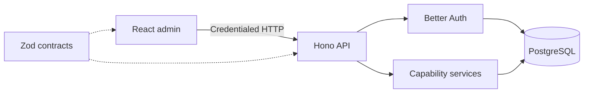

# Architecture

EduOS starts as a modular monolith: one browser admin app and one Node API, backed by PostgreSQL. Redis is provisioned for future jobs and is not a runtime dependency yet.

Packages: `contracts` owns wire schemas; `auth/server` configures identity and `auth/client` exports the browser client; `permissions` owns policy interfaces and default-deny resource checks; `database` owns SQL schema, pool, transactions and migrations; `ui` owns presentation primitives/tokens; configuration packages own strict TS and Oxlint policy.

Applications depend on shared packages. Shared packages cannot depend on apps. Contracts/permissions are dependency leaves and cannot access persistence. UI cannot import authentication or database code. Browser and server auth exports are separate. Package exports point to compiled ESM and declarations; Turbo builds dependencies first. `pnpm dev` builds shared packages once: restart after editing a shared package, or run its build in another terminal.

The API binds loopback; deploy behind a same-site TLS reverse proxy. Deployment, TLS, backups, email delivery and observability infrastructure are not provisioned by this bootstrap. See [verification](../development/verification.md) for actual checks and blockers.
