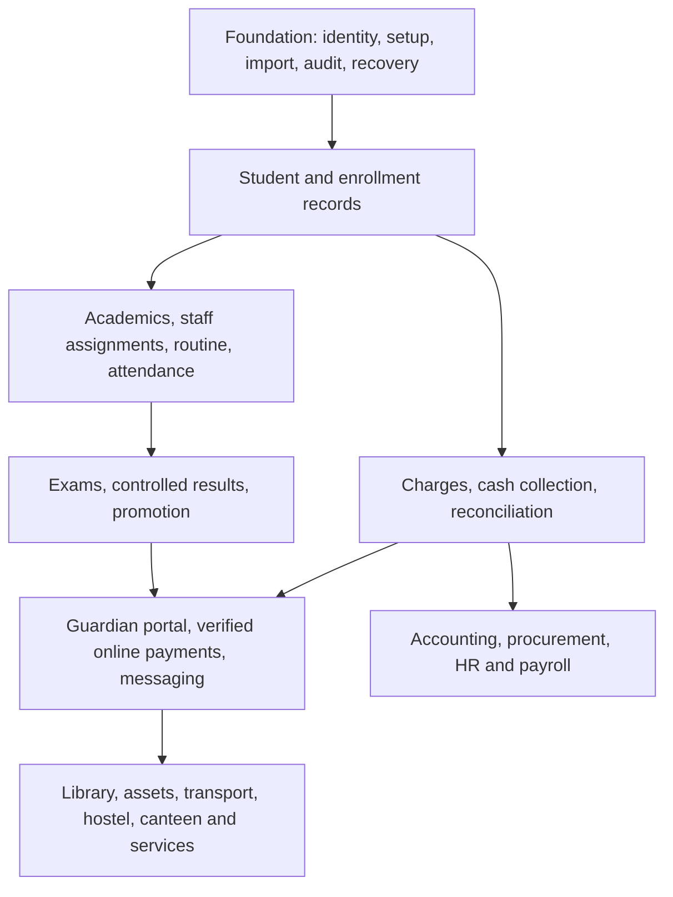

# Bangladesh school ERP: research and product plan

Research date: 31 October 2026. Status: proposed product direction, ready for school discovery and estimation. Owner: EduOS product team. This package does not approve new school policies or change the application.

## Recommendation

Build a Bangladesh-focused operating system for private schools, starting with Classes 1–10 and a dependable student-to-fee-to-result lifecycle. Establish accurate records, cash reconciliation, teacher attendance workflows, controlled results and guardian communication before expanding into every operational service.

The recommended initial customer is a single-campus Bangla-medium or English-version private school with approximately 200–1,500 students. This size range is a targeting hypothesis, not measured market demand. Include kindergarten feeder classes only after validating their assessment and fee differences. English-medium international curricula, colleges, madrasahs and coaching need separate discovery packs; an institution-type selector does not establish support for their academic rules.

Deliver the full ERP as a modular product over several releases. Library, payroll, transport, hostel and canteen belong in the product map, but should be activated according to the school's operations and willingness to pay. No school should have to configure services it does not run.

## Read the plan

| Document                                           | What it answers                                                                                               |
| -------------------------------------------------- | ------------------------------------------------------------------------------------------------------------- |
| [Market research](research.md)                     | Local competitors, price observations, official requirements, evidence limits and positioning                 |
| [35-module catalog](module-catalog.md)             | Scope, actors, workflows, records, controls and acceptance for every proposed module                          |
| [Screen and experience design](screen-design.md)   | Navigation, principal/cashier/teacher/guardian workspaces, module screens and interaction rules               |
| [Workflows and data design](workflows-and-data.md) | Domain ownership, lifecycle states, permission matrix, transactions and integration boundaries                |
| [Delivery and commercial plan](delivery-plan.md)   | Existing coverage, backlog, sequence, staffing assumptions, pricing tests, release gates and school discovery |

## Evidence and decision labels

- **Observed:** a public source or local repository file inspected for this plan; citations accompany market observations.
- **Vendor claim:** a supplier's own description or advertised price; no demo, customer count, uptime or security claim was independently verified.
- **Proposed:** an EduOS design or commercial hypothesis derived from the research.
- **Discovery required:** a rule that depends on the institution, board, session or contract.

This is desk research, not a representative survey. No schools, guardians or vendors were contacted. Vendor pages were inspected through public web search/open results. The linked original Google product specification could not be retrieved, so the current repository domain documents provide its local summary. No exact national private-school ERP revenue estimate is asserted. BANBEIS report listings were reachable; their latest report tables could not be extracted during this research. See the limitations in [research](research.md).

## Product map and release sequence

Some foundation and operational slices already exist locally. The diagram represents logical dependencies, not a claim that everything must be built again or strictly sequentially. The delivery plan starts with reconciliation of the existing implementation.

## Product outcomes

Proposed pilot targets, to be agreed after measuring school baselines:

| Outcome                   | Initial target                                                       | Measurement                                                               |
| ------------------------- | -------------------------------------------------------------------- | ------------------------------------------------------------------------- |
| Trusted migration         | All accepted student counts and opening balances reconcile           | Signed import reconciliation by school                                    |
| Daily attendance adoption | At least 90% of scheduled class registers submitted by school cutoff | Submitted registers / expected registers, excluding closures              |
| Finance trust             | Zero unexplained closing differences                                 | Cash count, recorded receipts, bank/mobile clearing and approved variance |
| Results correctness       | All signed sample cases match approved school calculations           | Golden-case comparison before publication                                 |
| Safe access               | All release-blocking authorization tests pass                        | Cross-tenant, revoked-user, assignment and guardian-link cases            |
| Operational readiness     | Restore succeeds within agreed pilot limits                          | Recorded isolated restore drill                                           |
| Commercial validation     | At least 3 of 5 pilot schools accept a paid renewal offer            | Written decision and reason after 60–90 days                              |

These are acceptance hypotheses, not achieved results or external benchmarks. Review them with pilot schools and adjust documented targets before launch.

## Scope discipline

The full design contains 35 product capabilities. Modules are product boundaries, not a requirement to create 35 services or repositories. Keep the existing modular monolith, shared contracts and separated platform console. Add infrastructure only when a real workload needs it.

The existing five school roles remain the baseline. Guardian/student access and librarian, HR, transport or front-desk duties require reviewed new relationship/permission designs; they must not inherit school administrator privileges. School and platform authorization remain independent.

Before implementing a module, approve its discovery answers, workflow examples, permissions, data contract, migration and acceptance cases. Before a pilot, complete production recovery, monitoring, provisioning and support preparation. Detailed UI mockups and final API/schema specifications should follow the validated workflows in this package.

## Immediate next work

Implementation has started with B01 verification and B03 regression coverage. See
the [implementation baseline and gap register](implementation-status.md) for
executed checks, current gaps and remaining release gates.

1. Recruit five contrasting schools and collect anonymized register/form samples with permission.
2. Audit the current working-tree functionality against the delivery inventory; verify migrations and tests in a dedicated test environment.
3. Resolve academic session, guardian authority, fee allocation, assessment and correction policies.
4. Turn the first release backlog into estimated tickets with named owners and dependencies.
5. Pilot reliable records, attendance and fees; run one exam cycle and one year-transition rehearsal before expanding sales.
