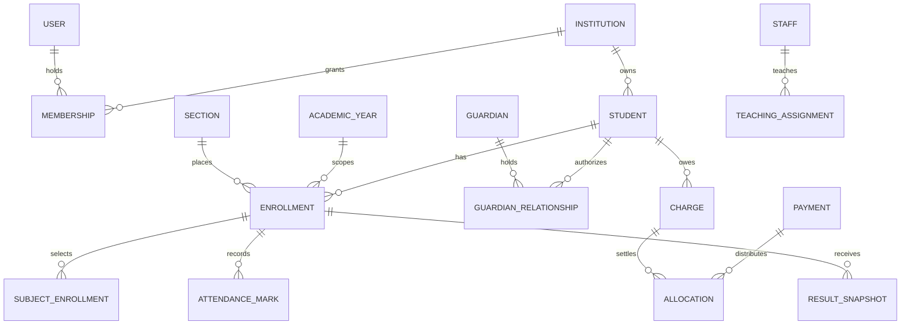

# Proposed workflows, boundaries and data design

This is a logical design, not an applied schema or ADR. Preserve the current modular monolith and review migrations/architecture decisions per implemented slice. Existing local behavior remains authoritative until an explicit change is approved.

## Domain ownership

| Context               | Owned concepts                                                              | Allowed collaboration                                                                                         |
| --------------------- | --------------------------------------------------------------------------- | ------------------------------------------------------------------------------------------------------------- |
| Platform              | Institution lifecycle, entitlements, SaaS invoices/subscriptions, operators | Provision identity/membership through owning services; never read student records through operator privileges |
| Identity/access       | Login identity, school membership, permission resolution, account recovery  | Resolve current membership, role, assignment and relationship at each data boundary                           |
| Institution/academics | Calendar, year, class/section/shift/version, subjects, rooms                | Provide effective roster/academic references to student, routine and assessment services                      |
| Student lifecycle     | Student/guardian identities, relationships, enrollment/placement, transfers | Admission conversion, historical roster reads and approved promotion through explicit services                |
| Admissions            | Candidates, interactions, selection, offers, decisions                      | Coordinate student/enrollment and admission charge creation in one transaction                                |
| Staff                 | Employment and teaching assignments                                         | Supply effective permission scope, routine availability and approved payroll inputs                           |
| Attendance/routine    | Register/mark/correction; routine/slot/version                              | Consume effective roster and assignments; enqueue approved notifications after commit                         |
| Assessment/results    | Exams, components, submissions, policy versions, result snapshots           | Read academic subjects; provide reviewed progression advice to lifecycle service                              |
| Finance               | Charges, allocations, receipts, settlements/refunds, GL/funds               | Accept approved charge requests from services; post balanced source-linked journal entries                    |
| Operations            | Procurement, assets, library, transport, boarding, canteen                  | Own service enrollment, custody and operational events; request finance entries through its service           |
| Communication         | Consent-aware audience, delivery/outbox, message budgets                    | Receive minimal source event and recheck recipient authority before delivery                                  |
| Reporting             | Authorized read models, report definitions, export jobs                     | Derive from owning records; never become a second source of marks or balances                                 |

Use focused modules under `apps/api/src/services/<capability>`; retain the school facade while evolving module-specific contracts and paginated reads. The current whole-school snapshot should not grow into every module's global data loader. Add capability APIs when scale and client needs justify them; do not perform a speculative rewrite.

## Logical relationships

Tenant keys and detailed constraints are omitted from the picture for readability; they remain mandatory. Each academic year, section, staff and finance reference must be validated within its institution. A guardian person record may be modeled per tenant initially; sharing a global login never makes another institution's relationships visible.

## Cross-cutting invariants

1. Stable person identity is distinct from annual enrollment, login, roll and phone. A staff member can lack a login; a login can have several explicitly authorized school memberships.
2. Every tenant row has an institution ID or documented enforced ownership path. Use composite ownership constraints for new references, plus service checks. Do not claim RLS protection: it is not enabled.
3. Scope uniqueness deliberately: for example enrollment per student/year, register per section/date/type and provider transaction per connection. Roll uniqueness depends on the confirmed section/shift policy.
4. Preserve effective dates, original attendance, published results, fee schedule snapshots and posted entries. End records or add amendments/reversals instead of deleting operational history.
5. Store financial values as checked integer minor units or an approved exact decimal type, with explicit rounding and allocation policy; never floating-point money. Match existing finance conventions before expanding them.
6. Calendar dates (birth, attendance date, term boundary) use date semantics; UTC `timestamptz` records actual instants. Timezone conversion must not move an attendance date.
7. Validate external requests and successful API responses with shared Zod contracts. Reject unknown privileged fields; derive actor and institution scope from verified context.
8. Mutations include operation identity and concurrency/version protection where retries or stale edits matter. Audit, state change and transaction receipt commit together.
9. Reauthorize on replay and before processing queued work. Idempotency does not allow a revoked user or relationship to bypass access checks.
10. Jobs and notifications carry minimal tenant-bound references. Add a transactional outbox when external payment/message workloads are implemented; do not assume an in-memory queue guarantees delivery.

## Admissions to active student

**Actors:** assigned Admission Officer, authorized reviewer and finance collector. **Trigger:** accepted offer/selection and required documents confirmed.

`inquiry → application → reviewed → selected/waitlisted → offered → accepted → admitted`

Rejected, declined, expired and withdrawn are explicit terminal/branch states; reapplication references prior intent. School-specific selection may be external lottery, document-based or approved internal process. Do not hardcode entrance exams.

Transaction at confirmation: recheck access and seat availability → validate intended year/section → create or match durable student after duplicate review → create enrollment → create approved charge snapshot → record confirmed cash collection if part of the command → issue receipt → audit outcome. Repeated confirmation returns the original result under current authorization. Failure rolls back all writes. A pending online payment is not confirmed cash.

Exceptions: duplicate identity requires human merge review; full section offers waitlisting or authorized placement; provider success with school transaction failure enters recovery/reconciliation, never silently loses the payment. Existing candidate-follow-up labels need mapping rather than destructive replacement.

## Charge to receipt to day close

**Actors:** authorized fee configurator, cashier, reviewer and accountant. **Trigger:** recurring assessment or approved one-time/service charge.

`schedule draft → approved schedule → assessment preview → posted charge → unpaid/partial/settled`

`payment initiated → pending verification → verified/failed/cancelled → allocated → receipted → reconciled`

Reversal, charge credit and cash refund are different actions. A financial reversal cancels the effect of an erroneous posting; a refund returns money and requires independent payment evidence. Keep source links between them.

For a verified collection, atomically create payment, allocations, receipt and audit; check outstanding amount under a suitable lock. Handle overpayment according to an approved rule: reject or retain an explicit unapplied credit. Do not silently reduce a future month's charge. Before closing, reconcile cash count, bank-cleared payments, mobile/provider settlement, pending items, refunds and authorized variance.

Provider callbacks: validate authenticity through provider contract → verify server-side status/amount/currency/merchant/reference → bind payment to originating tenant → deduplicate → post once. Browser success, screenshot and manually typed transaction ID never independently establish settlement. Reconcile gross paid, processing fee, net settlement and settlement date separately.

## Attendance to correction and guardian notice

**Actors:** effective class teacher/substitute, reviewer, authorized guardian. **Trigger:** scheduled school day and eligible roster.

`unopened → draft → submitted → correction requested → approved/rejected → amended effective register`

Compute a historical roster using active enrollment on the attendance date. Record all expected marks explicitly. Original submission stays immutable; approved correction adds history and updates the effective view. School closures and late admissions change expected counts through an approved rule.

Offline proposal: device stores only necessary roster/marks and expiry; each queue item carries actor, tenant, roster revision and operation ID. On reconnect, recheck authorization, dates and latest version. Show conflicts for review; do not last-write-win over submitted/corrected registers. Clear sensitive device data on logout and enforce an approved expiration/shared-device policy. Offline cash receipts are deferred until separate financial controls exist.

Only a committed, eligible absence event can queue communication. A correction may require a follow-up correction message. A failed SMS does not undo submitted attendance. The current app has local unsaved marks but no persistent offline queue; it must not be marketed as offline-ready yet.

## Exam to published result

**Actors:** exam coordinator, assigned subject teacher, reviewer and Principal. **Trigger:** approved exam/component and grade-policy versions.

`exam draft → scheduled → marks open → submitted → locked → calculated preview → reviewed → published → amended`

Persist rule version, source mark version and calculation engine version/reference for each publication. Validate components, missing marks, absence/exemption semantics, maximum marks, pass requirements and approved rounding before publication. School-signed golden cases must cover combined papers, electives, fail conditions, ties and descriptive assessment as applicable.

Publication is atomic for the approved scope; portal reads only published records. Amendments create a new publication version and explain affected students. Promotion consumes reviewed recommendations but belongs to M05. An exam result must not automatically impose a promotion or debt-clearance rule.

## Promotion and session close

Academic office creates the next year in draft, reviews eligible students against approved rules, records exceptions, assigns new class/section/roll and runs a dry-run comparison. Approval creates new enrollments with a batch ID and preserves previous ones. Reject duplicate next-year enrollments and conflicting placements.

Close academic, finance and payroll periods independently; they need not end on the same day. Carry receivables through explicit balances/history, rather than charging the same debt again. Unresolved result amendments, transfers and late collections remain accessible through authorized correction workflows. Rehearse the transition using synthetic history before a live year close.

## Proposed permissions matrix

This matrix is future design. Check the current role catalog before modifying grants. “Scoped” means assignment/record restrictions in addition to role. New portal or specialist access requires new explicit grants and contracts.

| Action                       | Admin                           | Principal                       | Admission Officer                        | Accountant                      | Teacher                            | Guardian/student                          |
| ---------------------------- | ------------------------------- | ------------------------------- | ---------------------------------------- | ------------------------------- | ---------------------------------- | ----------------------------------------- |
| Manage school membership     | Yes                             | Yes                             | No                                       | No                              | No                                 | No                                        |
| Configure academics/policies | Explicit grant                  | Explicit grant                  | No                                       | Finance config only if granted  | No                                 | No                                        |
| Candidate intake/follow-up   | Authorized school scope         | Authorized school scope         | Assigned scope                           | Finance view only if granted    | No                                 | Own application only if later supported   |
| Admit/promote/transfer       | Explicit grant                  | Explicit grant                  | Admit within policy                      | No                              | Recommendations only if assigned   | No                                        |
| Mark attendance              | Explicit grant                  | Explicit grant                  | No                                       | No                              | Assigned/date scope                | View linked published information only    |
| Review attendance correction | Explicit grant                  | Explicit grant                  | No                                       | No                              | Request within assignment          | Request only if enabled                   |
| Enter marks                  | Explicit exam grant             | Explicit exam grant             | No                                       | No                              | Subject/year scope                 | No                                        |
| Publish/amend results        | Explicit grant                  | Explicit grant                  | No                                       | No                              | No by default                      | No                                        |
| Collect/reconcile fees       | Explicit grant                  | Explicit grant                  | Existing permitted admission collections | Explicit grant                  | No                                 | Verified payment for permitted child/self |
| Waive/reverse/refund         | Separate approval grant         | Separate approval grant         | No by default                            | Request/execute only if granted | No                                 | Request only                              |
| Payroll/safeguarding details | Separate need-to-know grant     | Separate need-to-know grant     | No                                       | Payroll grant only              | Own payslip / designated case only | No broad access                           |
| Export records               | Permission plus row/field scope | Permission plus row/field scope | Assigned minimal scope                   | Finance scope                   | Assigned minimal scope             | Own allowed documents                     |

Platform Owner/Manager have **no implicit permission in any row**. Principal is an application role, not proof of authority to view every health/custody/safeguarding detail. Specialist extensions should grant named operations and scopes, rather than creating an unrestricted “staff” role.

## API, storage and job evolution

- Preserve existing URLs/layouts. New thin route pages compose colocated `_component` and `_api` files; generate routing output through the current tooling.
- TanStack Query owns server state. Query keys include identity, institution, relevant academic scope and filters; clear caches on logout/scope changes. No client policy/store is authoritative.
- Prefer explicit actions such as publish, submit, reverse and approve over unrestricted status-edit APIs. Return safe error codes, conflict details and stable operation/resource references.
- Add pagination/search to directories and report reads; index tenant + filter/date/order columns based on query plans and measured load.
- Replace neither current snapshots nor JSON configuration wholesale. Promote frequently queried or invariant-bearing fields into typed, constrained tables through reviewed additive migrations when required.
- Current expense evidence uses protected database-backed content. Before broad learning/document uploads, evaluate private object storage, quotas, signature/size checks, malware scanning and short-lived authorized downloads. Keep a migration path for existing evidence.
- Add durable job leasing, backoff, deduplication and dead-letter review for actual external delivery/export/payment work. Verify provider authentication; do not require browser Origin on machine callbacks blindly or disable protections for normal browser mutations.
- Large reports use authorized asynchronous exports with private expiration and scope rechecks; downloads must not become public object URLs.

## Operational acceptance examples

| Case                                               | Required outcome                                                               |
| -------------------------------------------------- | ------------------------------------------------------------------------------ |
| Cross-school ID injected into marks/payment/import | Denied before mutation; no foreign rows or private response                    |
| Teacher removed after opening register             | Subsequent save/queue replay denied; no trusted cached role                    |
| Guardian relationship revoked mid-session          | Next read/download/request denied for that child                               |
| Two cashiers allocate the same balance             | Serialized check prevents unauthorized over-allocation; deterministic conflict |
| Replayed callback/import/monthly billing           | One source effect; current authorization preserved                             |
| Partial admission transaction fails                | No orphan student/enrollment/charge/receipt                                    |
| Rule/calendar changed after publication            | Historical result/register/receipt remains reproducible                        |
| Database restored from backup                      | Constraints, audits and external reconciliation establish consistent recovery  |

Unresolved technical decisions for later ADRs: guardian identity/recovery, campus boundary, external payment accounting, outbox processing, offline encryption/expiry, general-ledger basis and object storage. This plan records options and requirements; it does not silently adopt those architecture changes.
